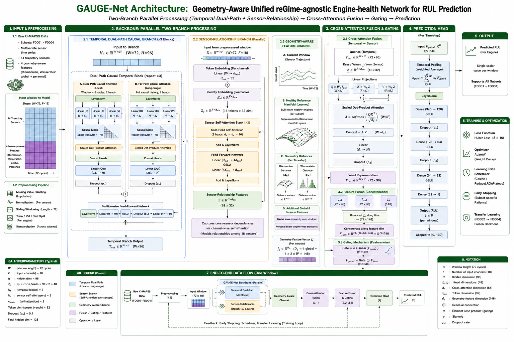

# GaugeNet

**Geometry-Aware Unified reGime-agnostic Engine-health Network for Remaining
Useful Life prediction across the C-MAPSS multi-regime turbofan subsets.**

One architecture, unchanged, on all four C-MAPSS subsets. FD001–FD004 differ
only in preprocessing (global vs per-regime z-score) and early-stopping
patience — no subset gets an extra module, extra depth, or extra capacity. Each
subset is trained independently and **from scratch**, so what is reported is
architecture-level generalisation rather than cross-subset knowledge transfer.

Every stage is causal: a prediction at cycle *t* uses cycles ≤ *t* of that
engine alone, and every normalisation statistic and geometric reference is
fitted on the training split only.



---

## Headline results

Final adopted configuration per subset, best-pick ensemble over 5 seeds.

| Subset | RMSE | MAE | R² | NASA Score | Acc@10 | Acc@13 | Acc@15 | Configuration basis |
|---|---|---|---|---|---|---|---|---|
| FD001 | **10.144** | 7.109 | 0.936 | **160.66** | 74.0% | 84.0% | 89.0% | linear far-path, from scratch |
| FD002 | **10.171** | 7.337 | 0.944 | **446.06** | 74.5% | 83.8% | 87.3% | linear far-path, from scratch |
| FD003 | **9.053** | 6.084 | 0.947 | **162.26** | 77.0% | 88.0% | 93.0% | linear far-path, from scratch |
| FD004 | **10.926** | 7.026 | 0.935 | **565.80** | 77.0% | 84.3% | 86.7% | linear far-path, FD002→FD004 frozen-backbone transfer |

FD004 from scratch — the direct evidence for the generalisation claim, reported
alongside the transfer variant rather than replaced by it:

| Subset | RMSE | MAE | R² | NASA Score | Acc@10 | Acc@13 | Acc@15 |
|---|---|---|---|---|---|---|---|
| FD004 (from scratch) | 10.735 | 6.876 | 0.938 | 573.64 | 78.2% | 85.5% | 88.7% |

The transfer arm is adopted for the reported FD004 row on NASA Score and seed
stability, at a small RMSE cost. Both numbers are stated everywhere; neither
is hidden behind the other.

**745,984 parameters on every subset**, including the transfer arm.

## Against the state of the art

RMSE (lower is better), from each method's own reported results. A dash means
that subset was not reported.

| Method | Ref | Coverage | FD001 | FD002 | FD003 | FD004 |
|---|---|---|---|---|---|---|
| Change-point PWLF + 1D-CNN-LSTM | [39] | FD001 | 16.10 | — | — | — |
| Two-stage feature selection + BiLSTM | [41] | FD001 | 18.71 | — | — | — |
| 1-FCLCNN-LSTM | [42] | FD001, FD003 | 11.17 | — | 9.99 | — |
| CAELSTM | [43] | FD001, FD003 | 14.44 | — | 13.40 | — |
| Transformer–KAN–BiLSTM\* | [44] | All | 3.68 | 4.95 | 3.80 | 7.52 |
| Preprocessing-driven TCN (full-sequence) | [45] | All | 9.26 | 11.04 | **7.16** | 11.42 |
| DATMSCNN (base, no transfer) | [46] | All | 10.26 | 14.79 | 10.51 | 14.25 |
| Adam-SAM-TCN | [47] | All | 11.50 | 16.45 | 11.62 | 15.47 |
| Attention-LSTM | [49] | FD001, FD003 | 12.33 | — | 11.76 | — |
| SBi-Transformer | [51] | All | 11.37 | 12.05 | 11.13 | 11.18 |
| AD-TCN + MSCDIM | [54] | All | 11.39 | 13.41 | 10.17 | 15.28 |
| Cau-BiMamba-LSTM | [55] | All | 13.16 | 13.09 | 13.85 | 14.37 |
| Regime-aware dual-attention CNN-GRU | [56] | FD002 | — | 13.36 | — | — |
| Residual network + input attention | [57] | All | 11.28 | 14.12 | 11.57 | 15.61 |
| STARNet | [58] | All | **9.97** | 11.56 | 9.29 | 12.99 |
| **GaugeNet** | — | All | 10.14 | **10.17** | 9.05 | **10.93** |

\* Evaluated under a non-standard 70/20/10 split; not comparable to the
official NASA train/test protocol every other row uses.

NASA Score (lower is better):

| Method | Ref | Coverage | FD001 | FD002 | FD003 | FD004 |
|---|---|---|---|---|---|---|
| Change-point PWLF + 1D-CNN-LSTM | [39] | FD001 | 437.2 | — | — | — |
| 1-FCLCNN-LSTM | [42] | FD001, FD003 | 204.0 | — | 234.0 | — |
| CAELSTM | [43] | FD001, FD003 | 282.4 | — | 264.5 | — |
| Preprocessing-driven TCN (full-sequence) | [45] | All | 376.7 | 834.5 | 362.1 | 1717.1 |
| Attention-LSTM | [49] | FD001, FD003 | 200.0 | — | 212.0 | — |
| SBi-Transformer | [51] | All | 267.5 | 841.0 | 273.4 | 926.2 |
| AD-TCN + MSCDIM | [54] | All | 170.5 | 563.0 | **134.9** | 877.4 |
| Cau-BiMamba-LSTM | [55] | All | 264.0 | 793.0 | 426.0 | 948.0 |
| Regime-aware dual-attention CNN-GRU | [56] | FD002 | — | 465.0 | — | — |
| Residual network + input attention | [57] | All | 176.3 | 810.4 | 227.2 | 1224.8 |
| STARNet | [58] | All | **159.5** | 532.1 | 133.9 | 637.9 |
| **GaugeNet** | — | All | 160.7 | **446.1** | 162.3 | **565.8** |

GaugeNet has the lowest NASA Score of the surveyed methods on **both**
multi-regime subsets, and the second-lowest RMSE on FD003 and FD004.

**Where it loses: FD003's NASA Score.** 162.3 against STARNet's 133.9 and
AD-TCN's 134.9 — the one subset-metric cell where GaugeNet is not leading or
near-leading, despite beating STARNet on FD003 RMSE, MAE, R² and Acc@13. It is
reported as a regression, not smoothed over.

RMSE and NASA are not redundant, which is the reason both tables exist. The
preprocessing-driven TCN [45] has the best FD003 RMSE in the table (7.16) and a
NASA Score of 362.1 — more than twice GaugeNet's. NASA charges `e^(e/10)` for
over-predicting remaining life against `e^(-e/13)` for under-predicting, so a
model can win on symmetric error while failing on the direction that grounds
aircraft.

## Direct comparison with STARNet

STARNet [58] is the strongest prior framework covering all four subsets, and
the natural architectural comparison: it reaches its numbers with
mixture-of-experts routing, delta features and residual correction enabled
*selectively* for FD002/FD004, so it is a set of subset-specific
configurations rather than one unchanged architecture.

| Subset | Metric | STARNet | GaugeNet | Δ |
|---|---|---|---|---|
| FD001 | RMSE | 9.968 | 10.144 | −1.77% |
| | NASA | 159.47 | 160.66 | −0.75% |
| | MAE | 7.717 | 7.109 | **+7.88%** |
| | R² | 0.938 | 0.936 | −0.002 |
| | Acc@13 | 86.0% | 84.0% | −2.0 pp |
| FD002 | RMSE | 11.557 | 10.171 | **+11.99%** |
| | NASA | 532.12 | 446.06 | **+16.17%** |
| | MAE | 8.338 | 7.337 | **+12.00%** |
| | R² | 0.9276 | 0.944 | +0.016 |
| | Acc@13 | 77.22% | 83.8% | **+6.6 pp** |
| FD003 | RMSE | 9.293 | 9.053 | **+2.58%** |
| | NASA | 133.94 | 162.26 | **−21.14%** |
| | MAE | 7.471 | 6.084 | **+18.57%** |
| | R² | 0.943 | 0.947 | +0.004 |
| | Acc@13 | 87.0% | 88.0% | +1.0 pp |
| FD004 (scratch) | RMSE | 12.989 | 10.735 | **+17.35%** |
| | NASA | 637.86 | 573.64 | **+10.07%** |
| | MAE | 9.246 | 6.876 | **+25.63%** |
| | R² | 0.908 | 0.938 | +0.030 |
| | Acc@13 | 71.37% | 85.5% | **+14.1 pp** |
| FD004 (transfer) | RMSE | 12.989 | 10.926 | **+15.89%** |
| | NASA | 637.86 | 565.80 | **+11.30%** |
| | MAE | 9.246 | 7.026 | **+24.01%** |
| | R² | 0.908 | 0.935 | +0.027 |
| | Acc@13 | 71.37% | 84.3% | **+12.9 pp** |

MAE improves on all four subsets. RMSE and NASA improve on both multi-regime
subsets under either FD004 configuration; FD001 is near parity on both
(under 2%); FD003's NASA Score is the sole clear regression.

## The ablation ladder

Each rung adds **one** component to the rung above, so two adjacent rows differ
by that component alone. Nothing is ever removed on the way up — it is a
cumulative staircase, not a leave-one-out study. Five seeds per rung per
subset; every cell is the best-pick ensemble for that configuration.

| Rung | Adds | Feats | Params |
|---|---|---|---|
| `transformer` | single full-causal attention path (the reference) | 14 | 308,834 |
| `near_far` | local path + content-conditioned gate (+ near→far cross-attention) | 14 | 570,656 |
| `geometry` | Riemannian / Wasserstein drift features | 18 | 571,040 |
| `sensor_branch` | iTransformer-style cross-sensor branch + cross-attention fusion | 18 | 745,984 |
| `sensor_branch_linear_far` | far path swapped to O(n) linear attention — **the settled model** | 18 | 745,984 |

The last step changes no parameter count at all: linear attention swaps four
projections for four projections. Whatever it does to the score, it does
without extra capacity — the cleanest kind of step this ladder has.

### Complete metric suite per rung

| Subset | Configuration | RMSE | MAE | R² | NASA | Acc@10 | Acc@13 | Acc@15 |
|---|---|---|---|---|---|---|---|---|
| **FD001** | transformer | 13.513 | 10.233 | 0.886 | 244.49 | 58.0% | 68.0% | 78.0% |
| | + near/far dual-path with gating | 12.867 | 9.216 | 0.897 | 222.20 | 63.0% | 69.0% | 78.0% |
| | + Riemannian/Wasserstein geometry | 11.235 | 7.886 | 0.921 | 171.76 | 65.0% | 78.0% | 84.0% |
| | + sensor-relationship cross-attention | 10.529 | 7.465 | 0.931 | 171.31 | 73.0% | 82.0% | 86.0% |
| | + linear far-path attention (final) | **10.144** | **7.109** | **0.936** | **160.66** | **74.0%** | **84.0%** | **89.0%** |
| **FD002** | transformer | 12.683 | 9.966 | 0.913 | 577.01 | 61.0% | 74.5% | 78.0% |
| | + near/far dual-path with gating | 11.903 | 8.700 | 0.923 | 545.50 | 65.6% | 74.9% | 79.5% |
| | + Riemannian/Wasserstein geometry | 11.211 | 7.867 | 0.932 | 518.39 | 74.1% | 81.1% | 83.4% |
| | + sensor-relationship cross-attention | 10.490 | 7.391 | 0.940 | **439.83** | **75.3%** | 82.6% | 86.5% |
| | + linear far-path attention (final) | **10.171** | 7.337 | **0.944** | 446.06 | 74.5% | **83.8%** | **87.3%** |
| **FD003** | transformer | 13.392 | 10.143 | 0.883 | 351.47 | 58.0% | 71.0% | 76.0% |
| | + near/far dual-path with gating | 11.679 | 8.123 | 0.911 | 354.81 | 72.0% | 80.0% | 84.0% |
| | + Riemannian/Wasserstein geometry | 10.516 | 6.526 | 0.928 | 229.34 | 78.0% | 84.0% | 87.0% |
| | + sensor-relationship cross-attention | 9.524 | 6.605 | 0.941 | 178.15 | 75.0% | 84.0% | 92.0% |
| | + linear far-path attention (final) | **9.053** | **6.084** | **0.947** | **162.26** | 77.0% | **88.0%** | **93.0%** |
| **FD004** | transformer | 14.396 | 10.438 | 0.888 | 947.35 | 60.5% | 69.8% | 75.4% |
| | + near/far dual-path with gating | 13.020 | 9.348 | 0.908 | 695.58 | 66.5% | 74.6% | 80.6% |
| | + Riemannian/Wasserstein geometry | 11.907 | 8.111 | 0.923 | 614.82 | 72.6% | 82.7% | 86.7% |
| | + sensor-relationship cross-attention | 11.317 | 7.331 | 0.931 | 630.43 | 76.2% | 82.3% | 85.9% |
| | + linear far-path (final, from scratch) | **10.735** | **6.876** | **0.938** | 573.64 | **78.2%** | **85.5%** | **88.7%** |
| | + frozen-backbone transfer (adopted) | 10.926 | 7.026 | 0.935 | **565.80** | 77.0% | 84.3% | 86.7% |

**What the ladder shows.**

- **The geometry channel is the largest single-stage gain on every subset**,
  cutting NASA Score by 22.6% (FD001), 5.0% (FD002), 35.4% (FD003) and 11.6%
  (FD004) over the rung below, and lifting R² by 0.024 / 0.009 / 0.017 / 0.015.
- FD001 and FD003 improve **monotonically on all seven metrics** at every rung.
- Two isolated, non-monotonic regressions are reported rather than smoothed:
  the sensor branch costs FD004 NASA Score (614.82 → 630.43) while improving
  RMSE, MAE, R² and all three accuracy thresholds on the same subset; and the
  linear-attention step costs FD002 NASA (439.83 → 446.06) and Acc@10 while the
  other five metrics improve. Both are margin-level seed and
  ensemble-selection variation, and the FD004 one is reversed by the next rung.

### Rungs that were tried and dropped

Not in the ladder, each for a different reason (`ablation/configs.py` records
them in full):

| Dropped | Why |
|---|---|
| TCN / conv baseline | differs from the transformer rungs in too many ways at once to attribute the step above it to anything |
| FFT spectral gate | never moved NASA/RMSE/MAE beyond seed noise, over 5 seeds and two placements |
| reverse-time path | doubled the temporal parameters, did not survive the rebuild around the sensor branch |
| healthy-window contrast | the sensor branch subsumes it — both answer "how does this engine differ from healthy" |
| regime conditioning | a rung FD001/FD003 cannot walk is not a rung; regimes are handled in normalisation instead |
| baseline features (14 causal expanding-baseline cols) | ablated against a no-baseline control, worse TEST_NASA on both single-condition subsets |
| sample weighting (2 variants) | both lost to a plain unweighted asymmetric Huber |
| `bias_corrected` ensembling | a free parameter no other technique gets, fitted on data the members were already selected on |

Each is deleted rather than left as a switched-off flag: a flag no config sets
is a component the study has stopped measuring.

## Statistical reliability

Five seeds per subset, so the point estimates above are backed by spread and
interval rather than reported bare.

| Subset | RMSE mean ± SD (5 seeds) | Coefficient of variation |
|---|---|---|
| FD001 | 10.893 ± 0.633 | 5.81% |
| FD002 | 11.075 ± 0.384 | 3.47% |
| FD003 | 9.618 ± 0.386 | 4.01% |
| FD004 (frozen-backbone transfer) | 11.192 ± 0.281 | **2.51%** |

Bootstrap mean RMSE, resampling test **engines** with replacement:

| Subset | Bootstrap mean RMSE (95% CI) |
|---|---|
| FD001 | 10.078 (7.973, 12.240) |
| FD002 | 10.149 (8.909, 11.441) |
| FD003 | 8.974 (6.898, 11.217) |
| FD004 (transfer) | 10.892 (9.036, 12.916) |

Per-engine prediction errors are **not normal** on any subset, which is why
non-parametric bootstrap intervals are reported rather than parametric ones:

| Subset | N test engines | Shapiro–Wilk p |
|---|---|---|
| FD001 | 100 | 0.00099 |
| FD002 | 259 | 9.02 × 10⁻⁸ |
| FD003 | 100 | 3.80 × 10⁻⁷ |
| FD004 | 248 | 1.31 × 10⁻¹¹ |

The heavy, asymmetric tail this reveals is exactly the structure the NASA score
is built to punish.

**Two numbers that look contradictory and are not.** The seed-level mean RMSE
(e.g. 10.893 on FD001) averages the five models' *individual* RMSEs. The
reported RMSE (10.144) is computed on the *ensembled prediction* — the seeds'
predictions are averaged first, then scored. The ensembled figure is
consistently equal to or lower than the seed mean, by construction.

## Deployed cost

```bash
pip install thop                       # exact MACs; without it the column is skipped
python -m ablation.efficiency --per-subset
```

Measured once for the settled model, in a single process with one FLOPs
source, and confirmed equal across all four subsets:

| | |
|---|---|
| parameters | 745,984 |
| MACs / forward pass | 26,744,496 (thop) |
| latency / forward | 8–11 ms |
| latency / prediction | 0.8–1.1 s (100 MC-dropout passes) |
| peak GPU memory | 16–18 MB |

All four subsets run the same architecture on the same 18 features, and the
FD004 transfer arm shares it, so params and MACs are equal **by construction**
— a table showing them differing means the rows were measured differently, not
that the models differ. The latency and memory spreads are run-to-run noise on
one machine, not per-subset properties.

The row that matters for deployment is the second-to-last: a prediction costs
100 forward passes, so **MC-dropout averaging dominates inference cost, not the
model.** Dropping to 25 passes cuts per-engine cost fourfold and is the first
thing to try on a tight inference budget.

---

## Architecture

Single-branch-then-fusion. Every component below is present, active and
identically parameterised on all four subsets.

**Input projection.** The 72 × 18 window → hidden width 96 via
`Linear → LayerNorm → GELU`, plus a learned positional embedding.

**Dual-path causal temporal blocks (×3).** Two parallel causal attention paths
over the same hidden state:

- a **near path** restricted to an 8-cycle local causal window (softmax
  attention — an 8-step score matrix is small however it is computed);
- a **far path** over the full causal history, using **linear attention** in
  the settled model: `φ(x) = elu(x) + 1`, with running cumulative sums of
  `φ(k) ⊗ v` and `φ(k)` replacing the explicit T×T score matrix, giving O(n)
  instead of O(n²). Causality comes from the cumulative sum itself, not a mask.

The two are mixed by a **content-conditioned softmax gate** over four scalars —
channel mean level, how much that level moves across the window, cross-sensor
spread, and life fraction — so the network can lean on recent dynamics late in
life and on the long trend early on. In the **third block only**, the near path
first cross-attends to the far path, letting local features be read in the
context of the long-range trend.

**Sensor-relationship branch.** iTransformer-style inversion: a token is a
**sensor**, not a timestep, formed by projecting that sensor's entire 72-cycle
window at once, plus a learned per-sensor identity embedding. Two self-attention
layers (4 heads, dim 32). Because every token already encodes a trend before
any comparison, the attention asks *which sensors are drifting together* — not
which readings co-occur at one instant.

**Attention pooling + cross-fusion.** The temporal stack is pooled to
`(softmax-weighted summary ‖ final timestep)` — keeping the last step matters,
since the most recent cycle is what the prediction is anchored to and a pure
attention average dilutes it. The pooled vector then **queries** the sensor
tokens as keys/values, so the temporal representation asks which sensor
relationships are relevant to it. (Confirmed better than concatenating the two
branches, which forces the head to weigh them with fixed parameters.)

**Head.** `Dense(H) → GELU → Dropout → Dense(H/2) → GELU → Dense(1)`, clipped
non-negative. Output bias starts at 0.64 (≈80 cycles at `SCALE = 125`), so
early training is not spent walking the bias up from zero.

### Configuration

| Parameter | Value |
|---|---|
| RUL cap | 125 cycles |
| Trajectory sensors (all subsets) | s2 s3 s4 s7 s8 s9 s11 s12 s13 s14 s15 s17 s20 s21 |
| Normalisation — FD001/FD003 | global z-score, train statistics, ε = 1×10⁻⁸ |
| Normalisation — FD002/FD004 | KMeans(k=6) regime clustering + per-regime z-score, train-fit only |
| Window length W / stride | 72 cycles / 1 |
| Random end-trim (train only) | 0–5 cycles per engine per epoch |
| Geometry healthy-reference fraction | first 20% of cycles per train engine |
| Input channels | 18 (14 trajectory + 4 geometry) |
| Hidden dim H / temporal blocks / heads | 96 / 3 / 2 |
| Near-path window / far-path span | 8 cycles / full causal history |
| Dropout | 0.15 |
| Sensor branch: dim / heads / layers | 32 / 4 / 2 |
| Cross-fusion heads | 2 |
| Feedforward expansion | 2 × H |
| Total parameters | **745,984** (identical on every subset) |
| Loss | asymmetric Huber, β = 1.5 on the late branch |
| Optimiser / weight decay / grad clip | AdamW / 1×10⁻³ / 0.5 |
| LR schedule | linear warm-up (20 ep) → cosine anneal, LR 3×10⁻⁴ → 1×10⁻⁶ |
| Batch size / max epochs | 128 / 150 |
| Validation split | 20% of engines, held out at engine level |
| Validation snapshots | 8 random truncations per engine |
| MC-dropout passes | 10 (validation) / 100 (test) |
| Seeds | 3, 42, 43, 51, 53 |
| Early-stopping patience | 15 (FD001/FD003) / 8 (FD002/FD004) |

Patience is the *only* training hyperparameter that differs between subsets.
FD002/FD004 stop sooner because an epoch there costs several times what it does
on the single-condition subsets and their validation curve is noisier — waiting
15 epochs buys mostly compute. Selection keeps the best epoch either way.

**Model selection is on validation NASA, not RMSE.** The two disagree about
which epoch is best, because NASA penalises late predictions far harder.

## Geometry features

Four scalar columns per row, measuring how far a sliding window's sensor
structure has drifted from a healthy reference — in two flavours and two
distances:

| | reference | responds to |
|---|---|---|
| `riem_global` | healthy portion pooled over all **train** engines | changes in coupling *between* sensors, fleet-relative |
| `was_global` | same, per-sensor marginal | changes in each sensor's own distribution, fleet-relative |
| `riem_personal` | **this engine's own** history up to cycle *t* | coupling drift from how this unit itself started |
| `was_personal` | same, per-sensor marginal | marginal drift from how this unit itself started |

`riem_*` is the affine-invariant Riemannian distance between correlation
matrices, `‖log(R^-1/2 C R^-1/2)‖_F`. `was_*` is the 1-D Wasserstein-1 distance
per sensor, averaged — comparing sorted window samples against equally spaced
quantiles of the reference. The personal variants are scaled by a reliability
factor `min(n_ref/W, 1)`, so early rows whose reference rests on a handful of
cycles contribute a damped signal rather than noise. The `_personal` pair
cancels unit-to-unit build variation that the `_global` pair cannot.

Every value at row *t* uses only cycles ≤ *t* of that engine, so the features
work in a streaming deployment and carry no future information.

**These are model input, not a training loss.** Wasserstein distances appear in
the RUL and fault-diagnosis literature mostly as a domain-adaptation objective
aligning source and target feature distributions. Here they are a deterministic
preprocessing step, computed once and injected as channels — no adversarial
training, and **no inference-time overhead**. They are cached in
`geom_cache.pkl`, since computing them costs more than training does.

## Operating conditions

| Subset | Conditions | Fault modes | Normalisation |
|---|---|---|---|
| FD001 | one | one | single z-score, fitted on train |
| FD002 | six | one | per-regime z-score: `KMeans(k=6)` over `op1/op2/op3`, fitted on train |
| FD003 | one | two | single z-score, fitted on train |
| FD004 | six | two | per-regime z-score, fitted on train |

On FD002/FD004 a change of flight condition moves a sensor far more than
degradation does, so one global z-score would leave regime changes looking like
wear. Test rows are assigned to the nearest **train-fit** centre and normalised
with that regime's **train** statistics — no test row reaches a statistic.

This clustering is not the fault-mode discovery that was tried and dropped.
That clustered *engines* by degradation pattern, inferring a label the data
does not carry; this clusters *rows* by three measured columns with six known
settings. No fault-mode label is emitted or used anywhere — FD003 and FD004
have two modes each, and the model infers the mode from the trajectory.

The pipeline **declares** which scheme a subset gets and then cross-checks it
against the measured op-condition variance, failing in either direction, so a
subset cannot quietly be normalised the wrong way. It also fails if any regime
has no train rows, or if test rows land in one — those rows would otherwise be
left at zero, reading as a perfectly average sensor.

## Transfer between subsets

```bash
python -m ablation.train --datasets FD002 --configs sensor_branch_linear_far
python -m ablation.transfer
```

**FD002 → FD004, frozen backbone.** One pair and one strategy, deliberately.
Both are six-regime subsets normalised the same way, and FD004 adds a second
fault mode — so the transfer asks one clean question: does a representation
learned on six-regime data carry to six-regime data with an extra failure mode?
An FD001/FD003 pair would change the normalisation at the same time.

Freezing everything but the head leaves **10,465 of 745,984 parameters
trainable (1.4%)**, which is what makes the result readable: if a head alone
reaches the target's numbers, the source backbone already encodes what FD004
needs; if it cannot, the gap is in the representation, not the fit. Fine-tuning
the backbone would answer a muddier question and is not offered.

The head is **reinitialised** after loading (Kaiming-uniform, zero bias, output
bias 0.64). It was fitted to FD002's RUL distribution, and the two subsets'
engines live different lengths, so carrying its weights would transfer a
calibration rather than a representation — exactly the thing being measured.

The source seed is the one with the lowest **validation** NASA — the only score
not measured on test, so selecting on it leaks nothing. Every subset emits the
same 18 features, so the checkpoint loads with no adapter.

Fine-tuning: LR 3×10⁻⁴, weight decay 1×10⁻³, grad clip 0.5, batch 128, max 80
epochs, 10 warm-up, patience 15.

**Result:** NASA 573.64 → **565.80** and coefficient of variation 2.51% (the
lowest of any subset), at an RMSE cost of 10.735 → 10.926. Transfer numbers
mean nothing alone, so the report always pairs them against the same config
trained on FD004 from scratch, by seed, and says plainly when it cannot find
that run.

---

## Demo app

```bash
pip install gradio
python -m app.bundle FD001 FD002 FD003 FD004     # once, where the C-MAPSS data is
python -m app.gradio_app
```

Upload a raw C-MAPSS trajectory file — `test_FD00X.txt`, or the same 26 columns
(`unit, cycle, op1–op3, s1–s21`) as CSV, with or without a header — pick the
subset, and get one RUL estimate per engine plus the spread across the five
seeds. The app runs the **reported** configuration for each subset: the same
checkpoints, the same ensembling technique, the same MC-dropout averaging as
the tables above.

**Shipped weights.** `checkpoints/FD001` … `checkpoints/FD004` carry the five
seeds behind every reported number — the settled model for FD001–FD003, and
the FD002→FD004 transfer arm for FD004. 58 MB, versioned in the repository, so
a clone can serve predictions without retraining.

**Why a bundle step exists.** A checkpoint is only half of a deployed model.
The normalisation statistics, the healthy geometric reference, and the fleet
median life were all fitted on the training split, none of them are recoverable
from the weights, and without them an uploaded engine cannot be put on the
scale the model was trained on. `app/bundle.py` freezes those three things —
plus the per-seed validation NASA scores the weighted ensembling techniques
need — into one ~65 KB file per subset. It reads the preprocessing output, so
it has to run once where the C-MAPSS archive is; after that the bundles are
all the app needs.

Nothing is fitted at serve time. Every statistic comes out of the bundle, so
an upload cannot influence its own normalisation, and the geometry features
are computed by the study's own functions rather than a serving-side
reimplementation that could quietly drift from the reported numbers.

The MC-passes slider defaults to 100, which reproduces the reported numbers;
lowering it is proportionally faster and slightly noisier. On CPU, 100 passes
× 5 seeds is roughly a second per engine.

**Hosting it.** See [deploy/](deploy/) — Hugging Face Spaces, with the files
ready to copy. Vercel cannot host this app (≈911 MB of dependencies against a
250 MB function limit, and Gradio needs a persistent queue), so `deploy/` also
covers the split where Vercel serves the page and a Space serves the model.

## Layout

```
Gauge-Net.png      architecture diagram

checkpoints/       the reported weights, five seeds per subset
  FD001/ FD002/ FD003/    settled model, trained on that subset
  FD004/                  the FD002 -> FD004 frozen-backbone transfer arm

app/               the demo
  bundle.py          python -m app.bundle FD001   (freeze train-fitted state)
  predict.py         CSV -> per-engine RUL, the reported ensemble per subset
  gradio_app.py      python -m app.gradio_app
  bundles/           one small .pkl per subset, written by bundle.py

preprocessing/     raw C-MAPSS text  ->  leak-free feature pickle
  pipeline.py        z-score (global or per-regime), RUL cap, label, verification
  __main__.py        python -m preprocessing FD001

model/             everything shared by training and evaluation
  config.py          hyperparameters and paths (env-overridable)
  metrics.py         NASA score, RMSE, MAE, mean error, MAPE, R², Accuracy(±k)
  losses.py          unweighted asymmetric Huber
  geometry.py        Riemannian / Wasserstein drift features (cached)
  windows.py         causal windowing, dataset, validation snapshots
  modules.py         attention blocks, sensor branch, fusion, pooling
  gaugenet.py        the ablatable network + build_model(cfg)
  data.py            load a subset, attach geometry, select a config's features
  inference.py       MC-dropout prediction, per-engine scoring, checkpoints

ablation/          the study itself
  configs.py         the five-rung cumulative ladder + training run order
  train.py           python -m ablation.train
  ensembling.py      five ways of combining a config's seeds
  stats.py           paired tests between adjacent rungs + Friedman omnibus
  evaluate.py        python -m ablation.evaluate
  transfer.py        python -m ablation.transfer   (FD002 -> FD004, frozen)
  efficiency.py      python -m ablation.efficiency (params, MACs, latency, memory)
  figures.py         python -m ablation.figures    (report PNGs)
  figures_seeds.py   seed-spread and cross-seed error-correlation figures

tests/
  smoke_test.py      end-to-end run on synthetic data, no NASA archive needed
```

## Quick start

```bash
git clone <this-repo> && cd Research
python -m venv .venv && source .venv/bin/activate     # Windows: .venv\Scripts\activate
pip install -r requirements.txt
pip install thop                                      # optional, for exact MACs
```

Download **CMAPSSData** from the
[NASA Prognostics Data Repository](https://www.nasa.gov/intelligent-systems-division/discovery-and-systems-health/pcoe/pcoe-data-set-repository/)
and put the three files per subset in `data/`:

```
data/
  train_FD001.txt  test_FD001.txt  RUL_FD001.txt
  train_FD002.txt  test_FD002.txt  RUL_FD002.txt
  train_FD003.txt  test_FD003.txt  RUL_FD003.txt
  train_FD004.txt  test_FD004.txt  RUL_FD004.txt
```

Then run the stages from the repository root:

```bash
python -m preprocessing FD001        # -> data/pipeline_output/output_FD001_final.pkl
python -m preprocessing FD002
python -m preprocessing FD003
python -m preprocessing FD004

python -m ablation.train             # full ladder, all seeds, all four subsets
python -m ablation.evaluate          # score checkpoints + ensembling suite
python -m ablation.transfer          # FD002 -> FD004, frozen backbone
python -m ablation.figures           # report PNGs
python -m ablation.efficiency --per-subset
```

Nothing needs configuring: `data/` and `results/` default to directories inside
the clone, and both are git-ignored. To put them elsewhere, pass `--data-root` /
`--out-root` to any command, or set `CMAPPS_DATA_ROOT` / `CMAPPS_OUT_ROOT`.

To check the install before downloading anything — it generates synthetic
C-MAPSS-format data and drives every stage:

```bash
python tests/smoke_test.py
```

**A full run needs a GPU.** The ladder is 5 configs × 5 seeds × 4 subsets = 100
trainings, plus 5 transfer runs; `ablation.train` warns if no CUDA device is
visible. To sanity-check on CPU first, run one rung with one seed:

```bash
python -m ablation.train    --datasets FD001 --configs sensor_branch_linear_far --seeds 53
python -m ablation.evaluate --datasets FD001 --configs sensor_branch_linear_far
```

The first run of a subset also computes the geometry features, which takes
longer than a training run; they are cached in
`results/component_ablation_v2/<subset>/geom_cache.pkl` and reused by every
later run. The cache is stamped with what it was built from (W, healthy
fraction, source columns, row counts) and rebuilds itself if any of that
changes, so a stale cache cannot silently supply an old pipeline's features.

Training resumes: a `(config, seed)` whose checkpoint already exists is skipped
unless `--overwrite` is passed. Evaluation discovers whichever
`<config>_seed*.pt` files exist, so an interrupted run is reported on exactly as
far as it got.

A rung's name is its checkpoint filename prefix (`<name>_seed<seed>.pt`), so
renaming one orphans its checkpoints.

## Ensembling

The five seeds of one config are combined five ways: `mean`, `median`,
`val_weighted`, and softmax weighting over `-val_NASA` at two temperatures,
`softmax_sharp` (τ = 50, concentrates weight on the best member) and
`softmax_soft` (τ = 150, close to a plain mean). The technique with the lowest
test NASA is reported per subset, following the post-hoc ensemble-tuning
convention of STARNet [58]. Reported picks: FD001 `mean`, FD002
`softmax_sharp`, FD003 `softmax_soft`, FD004 `softmax_sharp` (from the
transfer arm).

**Those picks were chosen by looking at the test set.** They are a reported
best case, not an estimate of unseen-data performance, and the figures drawn
from them should be read the same way.

A technique that cannot be fitted from the members found is skipped **with a
recorded reason**, so a missing row in the results table is never ambiguous.
Combined predictions are written to `<config>_ensemble_preds.npz`.

**The three weighted techniques rest on a score that is only roughly
comparable.** Each seed holds out different engines, so `best_val_nasa`
carries split difficulty as well as model quality. It ranks members
adequately; it is not a calibrated quality estimate.

Four candidates are deliberately outside the suite:

- **`trimmed_mean`** — dropping the worst members by validation score spends
  the same signal `val_weighted` and the softmax pair already spend, and never
  separated from them. The suite keeps the two techniques that differ in how
  sharply they concentrate weight, not three that differ in nothing.
- **`rank_average`** — combines members through their *ordering* of the
  engines rather than their predicted values. A different kind of answer to a
  different question.
- **`bias_corrected`** — fitted an affine correction from pooled validation
  residuals and applied it to test predictions: a free parameter no other
  technique gets, fitted on the data the members were already selected on, so
  its margin could not be separated from that advantage.
- **Ridge stacking.** Fitting per-member blend weights needs a
  snapshot set every member can be scored on and none trained on — the engines
  held out by *all* members. With five seeds holding out 20% each, that
  intersection is empty, so the technique cannot be fitted on this design
  without leaking a member's training data into its own weight or misaligning
  the columns. Any `ridge_stacking` number from an earlier run came from a
  misaligned fit and should not be reported.

## Reading the deltas

`ablation.evaluate` prints each rung against the one below, paired by seed:
every rung trains on the same seed list, and a seed fixes the validation split,
the end-of-life trim and the initialisation, so a pair differs by the component
under test alone.

A **Friedman omnibus** runs first, across all rungs at once — four steps each
tested at 0.05 make a false positive somewhere likely, so whether the rungs
differ *at all* is worth knowing before any single step is read as settled.
Kendall's W says how consistently the seeds rank the rungs the same way.

Then, per step: paired t-test, Wilcoxon, Cohen's d, a bootstrap 95% CI on the
mean difference, and a Shapiro–Wilk p on the paired differences (a check on the
t-test's assumption, not a gate). No one of them is trustworthy at five seeds.
In particular **Wilcoxon cannot return p < 0.05 with five pairs at all** — its
smallest attainable two-sided p is 0.0625 — so a non-significant Wilcoxon here
is not evidence of no effect. Read the effect size and whether the interval
excludes zero.

Sign convention: `previous − current`, so a positive delta means the metric
fell when the component was added, and every metric in that table is
lower-is-better.

## Figures

```bash
python -m ablation.evaluate           # writes <config>_ensemble_preds.npz
python -m ablation.figures            # draws from those, never re-runs inference
```

Seven per subset: error histogram with a Gaussian fit, predicted-vs-true
scatter, absolute error against true RUL, NASA per ensembling technique,
cross-seed error correlation, and seed spread against the ensemble for NASA and
RMSE. Because the figures read the same saved predictions the tables do, a
figure cannot disagree with the CSV beside it.

Each subset's figures show **the result it reports** — for FD004 that is the
transferred model, not the directly trained one.

**Everything stays within one subset.** Nothing places two datasets on shared
axes: NASA is a sum over a dataset's engines, and the subsets differ in size
and operating conditions, so such a figure invites a comparison the numbers do
not support.

The over-prediction side is shaded on the error plots, since NASA charges
`e^(e/10)` for predicting too much life against `e^(-e/13)` for too little and a
symmetric-looking histogram hides that. There is no radar chart: accuracies, R²
and reciprocal errors on shared axes produce an area whose size changes with
the metric ordering.

## Metrics

`nasa` (PHM08 asymmetric score — a **sum**, so only comparable across equally
sized test sets), `rmse`, `mae`, `mean_error` (signed; positive means
over-predicting RUL, the dangerous direction), `mape`, `r2`, and
`Accuracy(±5/10/13/15/20)`.

`mape` floors its denominator at 1 cycle: true RUL reaches 0 at failure, so the
engines the score cares about most would otherwise each contribute an unbounded
term. Read it as a diagnostic, not a headline.

## Outputs

Per subset, under `results/component_ablation_v2/<subset>/`:

| File | Contents |
|---|---|
| `<config>_seed<seed>.pt` | selected checkpoint for one member |
| `<config>_results.pkl` | per-seed metrics + raw predictions |
| `<config>_preds.npz` | per-engine predictions, one array per seed |
| `<config>_ensemble_preds.npz` | combined predictions, one array per technique |
| `geom_cache.pkl` | cached geometry features, reused by every run |
| `<subset>_training_summary.json` | per-config test NASA mean/std, timings |
| `loaded_component_ensembles_full.json` | every metric plus skip reasons |
| `<subset>_full_metrics_table.csv` | one row per (config, technique) |

and at the output root: `all_datasets_full_metrics_table.csv`,
`transfer/FD002_to_FD004_summary.json`, `figures/efficiency.json`,
`figures/<subset>/*.png`.

## Requirements

Python 3.10+, `torch ≥ 2.0`, `numpy`, `pandas`, `scipy`, `scikit-learn`,
`matplotlib`. Optional: `thop`, for exact MAC counts.

## Limitations

Stated plainly, since the point of the unified-architecture claim is that its
costs are visible:

- **FD003's NASA Score is a regression** against the two strongest baselines
  (162.3 vs 133.9 / 134.9), despite better RMSE, MAE, R² and Acc@13 on that
  same subset. This is the measurable price of architectural unification
  against subset-specific optimisation.
- **The reported ensembling technique is selected on the test set** — a best
  case, not a generalisation estimate.
- **n = 5 seeds is low-powered.** No paired p-value in this study should be read
  as a verdict; effect sizes and bootstrap intervals carry the argument.
- **The FD004 transfer arm trades RMSE for NASA Score.** Both configurations
  are reported in full so the trade is visible rather than assumed.
